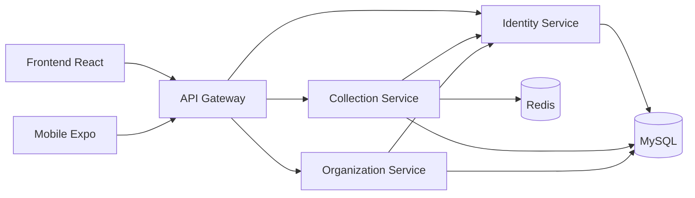

<div align="center">

# CAN

### Plataforma integrada para gestão de pontos e operações de coleta

Uma solução acadêmica composta por aplicação web, aplicativo móvel e backend distribuído, criada para aproximar usuários, coletores e organizações em torno de um fluxo de coleta organizado e rastreável.

</div>

## Sobre o projeto

O CAN é um Trabalho de Conclusão de Curso que reúne diferentes aplicações em uma única plataforma. O sistema permite cadastrar e consultar pontos de coleta, administrar usuários e organizações, acompanhar operações e centralizar o acesso às funcionalidades por meio de uma API.

O projeto foi estruturado para manter cada produto independente, sem perder uma visão integrada do sistema:

- **Web:** painel React para usuários e administração;
- **Mobile:** aplicativo React Native e Expo para acesso em dispositivos móveis;
- **Backend:** API Gateway, serviços de domínio e infraestrutura de dados;
- **CAN:** super-repositório que reúne os componentes e a orquestração Docker.

## Arquitetura



Os clientes acessam apenas o API Gateway. Os microserviços permanecem isolados na rede interna Docker e são encontrados por DNS de serviço, sem exposição direta de portas no host.

## Organização dos repositórios

| Repositório | Responsabilidade |
|---|---|
| [`CAN`](https://github.com/TCC-CAN/CAN) | Visão completa, submódulos e orquestração Docker |
| [`backend`](https://github.com/TCC-CAN/backend) | Gateway, microserviços, migrations e infraestrutura |
| [`frontend`](https://github.com/TCC-CAN/frontend) | Aplicação web React/Vite servida por Nginx |
| [`mobile`](https://github.com/TCC-CAN/mobile) | Aplicativo React Native com Expo Router |

> Alguns repositórios podem exigir permissão de acesso enquanto o trabalho estiver em desenvolvimento.

## Infraestrutura Docker

```text
CAN
├── frontend
└── backend
    ├── db
    │   ├── MySQL
    │   └── phpMyAdmin
    ├── cache
    │   └── Redis
    └── server
        ├── Migrator
        ├── API Gateway
        ├── Identity Service
        ├── Collection Service
        └── Organization Service
```

O aplicativo mobile é executado diretamente pelo Expo e não precisa de container.

## Tecnologias principais

- React, Vite e Nginx;
- React Native, Expo e Expo Router;
- Node.js e Express;
- MySQL e Redis;
- Docker e Docker Compose;
- GitHub Actions.

## Como obter o projeto completo

```bash
git clone --recurse-submodules https://github.com/TCC-CAN/CAN.git
cd CAN
cp .env.example .env
docker compose --env-file .env -f compose.yaml up -d --build
```

Antes da primeira execução, substitua todas as credenciais e segredos de exemplo no arquivo `.env`.

## Objetivo acadêmico

Além de entregar uma aplicação funcional, o CAN demonstra integração entre diferentes clientes, separação de responsabilidades no backend, automação de testes, migrations versionadas, containers com health checks e uma infraestrutura reproduzível.

---

<div align="center">
Desenvolvido como Trabalho de Conclusão de Curso pela organização <strong>TCC-CAN</strong>.
</div>